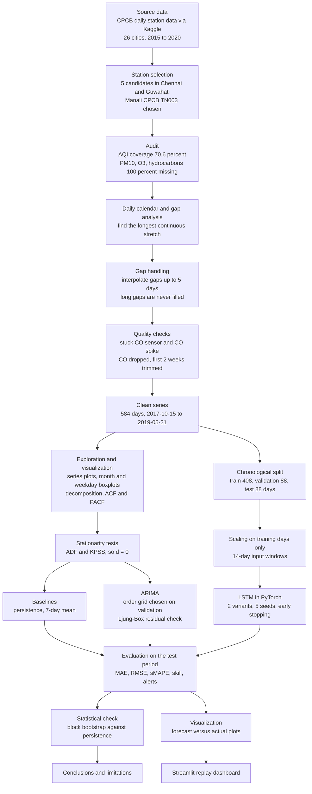
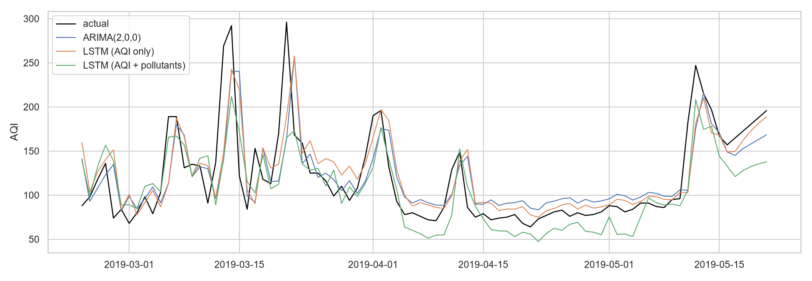
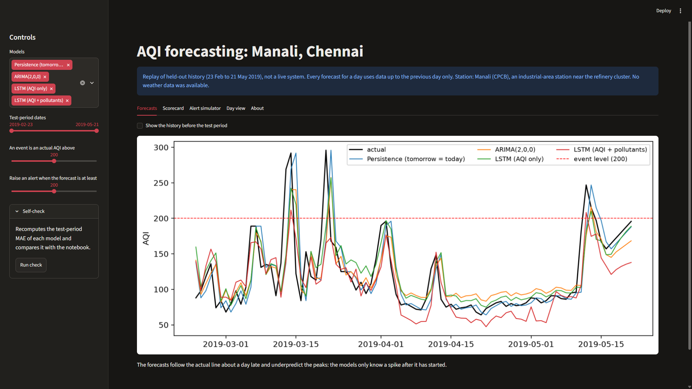
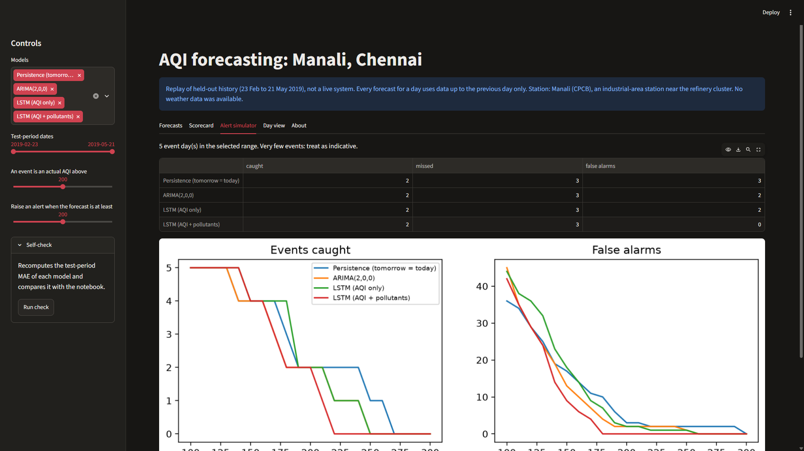

# AQI Forecasting Around a Refinery Zone: ARIMA and LSTM

Forecasting the next-day Air Quality Index (AQI) at an industrial-area monitoring station in Manali, Chennai, next to the Chennai Petroleum Corporation Limited (CPCL) refinery, using ARIMA and an LSTM neural network, compared against simple baselines. CPCL is an Indian Oil group company (confirm on Indian Oil's website before submission).

## 1. Problem and objective
Indian Oil Corporation wants to forecast AQI around its refinery zones from historical pollutant levels, so that emission control can be proactive. This project builds ARIMA and LSTM one-day-ahead forecasters, evaluates them honestly against baselines on held-out data, and shows how forecasts could drive an alert system.

## 2. Data
- **Source:** Central Pollution Control Board (CPCB) daily station data, via the Kaggle dataset "Air Quality Data in India (2015-2020)". The download contains no licence file, so the data is not redistributed here; see `data/README.md` for how to obtain it.
- **Station choice:** five candidates in Chennai and Guwahati were compared. **Manali, Chennai - CPCB (TN003)** was chosen: it is an industrial-area station with the longest industrial record. The Manali Village (TNPCB) station has only 320 usable days, and Alandur and Velachery are traffic and residential stations.
- **Coverage at the chosen station:** 2015-01 to 2020-07, 1,419 usable AQI days out of 2,009 (70.6%). PM10, O3, benzene, toluene and xylene are 100% missing; PM2.5, NO, NO2, NOx, NH3 and SO2 are 24-28% missing; CO is 5% missing.
- **This is not fence-line data.** The station is the nearest industrial-area monitor to the refinery cluster, not a monitor at the refinery boundary.

## 3. Workflow

## 4. Pre-processing (notebooks 01-03)
| Step | What and why |
|---|---|
| Daily calendar | The data is reindexed to one row per calendar day, so missing days appear as blanks. Time-series models need an unbroken calendar. |
| Gap analysis | The longest nearly continuous AQI stretch was found after bridging gaps of up to 5 days: 2017-09-28 to 2019-05-21 (601 days, 15 AQI values interpolated). Gaps of 82 and 411 days were not filled, because inventing months of data would be dishonest. |
| Stuck sensor | CO is exactly 0.0 for 32 days (2017-12-08 to 2018-01-08) and spikes to 15-40 on 10-13 October 2017. CO is not used as a model input, and the first two weeks were trimmed, giving **584 days (2017-10-15 to 2019-05-21)**. |
| Remaining gaps | Pollutant gaps up to 5 days were interpolated, and the last two days were filled by copying the previous day (no future data). |
| Real extreme | AQI peaks at 482 on 19 October 2017 (Diwali) with PM2.5 at 311, and is kept as a genuine event. |
| Stationarity | ADF p = 0.0002 and KPSS p >= 0.1 agree that AQI is stationary, so no differencing (d = 0). Differencing created artificial negative autocorrelation. |
| Seasonality | Weekly pattern is negligible (about +/- 5 AQI); monthly pattern is strong (January median about 190, April to June about 75), but under two years of data is too little to learn it reliably. |
| Split | Chronological, never shuffled: train 2017-10-15 to 2018-11-26 (408 days), validation 2018-11-27 to 2019-02-22 (88), test 2019-02-23 to 2019-05-21 (88). |

## 5. Methods (notebooks 03-05)
- **Baselines:** persistence (tomorrow = today) and a 7-day mean.
- **ARIMA:** orders p = 0-3, q = 0-2, d = 0 were compared on one-step-ahead validation error. ARIMA(2,0,0) was chosen as the simplest among near-tied candidates (validation MAE 49.6 to 50.9). Coefficients: AR(1) 0.84, AR(2) -0.17, both significant; the Ljung-Box test on the residuals gives p = 0.41 and 0.19, so no autocorrelation is left. Parameters are held fixed while forecasting each test day, and the model for the test period was re-fitted on train plus validation.
- **LSTM (PyTorch):** 14-day input window, one LSTM layer with 32 units, Adam (learning rate 1e-3), early stopping on validation loss, scaling fitted on training days only. Two variants: AQI only, and AQI plus lagged PM2.5, NO2, SO2 and NH3. Each was trained with 5 random seeds and the predictions averaged. Window length was chosen by validation (7, 14 and 21 days; 14 best).
- **No target leakage:** forecasts for day t use only data up to day t-1. AQI is computed from the pollutants, so same-day pollutants are never used as inputs.

## 6. Results
One-day-ahead forecasts on the 88-day test period:

| Model | MAE | RMSE | sMAPE % | Skill vs persistence |
|---|---|---|---|---|
| Persistence | 24.38 | 40.79 | 17.80 | 0 |
| 7-day mean | 31.07 | 46.39 | 23.76 | -0.27 |
| ARIMA(2,0,0) | 25.71 | 36.99 | 20.08 | -0.05 |
| LSTM, AQI only | 23.33 | 35.09 | 17.98 | +0.04 |
| LSTM, AQI + pollutants | 26.35 | 35.45 | 23.00 | -0.08 |

Run-to-run spread of the LSTM test MAE over 5 seeds: 23.51 +/- 0.64 (AQI only) and 26.65 +/- 1.20 (with pollutants).

**Interpretation**
- **No model is shown to beat persistence on average error.** Block-bootstrap 95% intervals for the MAE difference against persistence all include zero: ARIMA -2.6 to +4.7, LSTM (AQI only) -4.5 to +2.0, LSTM (with pollutants) -5.6 to +7.1. ARIMA and the LSTMs have lower RMSE (35 to 37 against 41), meaning fewer large misses.
- **The pollutant LSTM was better on validation (winter) and worse on test (spring).** In the plot it is biased low through April and May. The model was not re-selected after seeing the test results; both variants are reported.
- **All models lag the actual AQI by about a day and underpredict the peaks.** Spikes are largely weather-driven, and no weather data was available.
- **Alerts (AQI above 200):** the test period has only 5 event days. Every model caught 2 and missed 3; false alarms were 3 (persistence), 2 (ARIMA), 2 (LSTM, AQI only) and 0 (LSTM with pollutants). With so few events this is indicative only.
- Error levels depend on the regime: persistence had an MAE of 50 on the winter validation period and 24 on the calmer test period.

## 7. Dashboard (Streamlit)
A small page replays the saved test-period forecasts: forecast plots, a scorecard recomputed for any date range, an alert simulator (event level and alert level sliders, with caught, missed and false-alarm counts), a day view and a self-check that compares the scorecard with the notebook. It runs only on your own computer and contains no live model.

FILL IN: add two screenshots saved as `figures/app_forecasts.png` and `figures/app_alerts.png`, then uncomment the next two lines.
<!--  -->
<!--  -->

## 8. Limitations
See `reports/limitations_log.md`. The main ones: one station near, not at, the refinery fence line; no weather data; CO unusable and PM10, O3 and hydrocarbons missing; only a handful of event days in the test period; under two years of continuous data; the LSTM was not extensively tuned; ARIMA was re-fitted on train plus validation while the LSTM used the training period only; the data ends in 2019 for this stretch, and the dashboard replays history instead of forecasting live.

## 9. How to run
1. Python 3.14 was used (FILL IN if different: the output of `python --version`).
2. `python -m pip install -r requirements.txt`
3. Download the dataset as described in `data/README.md` into `data/raw/`.
4. `python -m jupyterlab`, then run in order, using Restart Kernel and Run All Cells in each: `02_clean_and_explore`, `03_explore_series`, `04_baselines_arima`, `05_lstm`. (`00_setup_check` tests the environment and `01_data_audit` is the station audit.)
5. Dashboard: `python -m streamlit run app.py`.

Note: TensorFlow does not support Python 3.14, so the LSTM is written in PyTorch.

## 10. Team and contributions
| Name | Contribution |
|---|---|
| FILL IN | FILL IN |

## 11. Acknowledgements
Data: CPCB via Kaggle ("Air Quality Data in India 2015-2020"). FILL IN: a line about AI assistance here if your course requires disclosure.